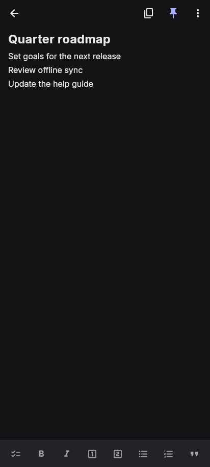

# Notes

Notes is an offline-first personal notes app for Android and native Linux,
built with Flutter. Notes are stored locally in an encrypted SQLite database;
device-to-device sync is optional.

## Download

- [Android arm64 APK](https://github.com/mmoptibuilds-commits/notes-app/releases)
- [Linux x64 archive](https://github.com/mmoptibuilds-commits/notes-app/releases)

[](https://rookieenough.github.io/Orion-Data/app/?id=notes-app)

No stable release has been published yet. `v1.0.0-preview.1` is a pre-release,
and the Orion Store listing offers a download only once a stable release exists.

You need Android 7.0 or later (in-app updates need Android 9 or later), or a
Linux x64 desktop with GTK 3 and GLib runtime libraries.

### Verify a Linux download

Verify the archive **before** extracting or running anything from it. You need
`openssl` 3.0 or later, `sha256sum`, `sed` and `base64`, which most
distributions install by default (check with `openssl version`). You do not
need Dart, Flutter or a copy of this repository.

The `.sha256` file beside the archive only detects a damaged download: it comes
from the same place as the archive, so it cannot prove the archive is genuine.
The signed manifest can. Download `notes-manifest.json`,
`notes-manifest.json.sig` and the archive from the same release, save the
release public key shown in [Release signing key](#release-signing-key) as
`notes-release.pem`, and run, with the release's version in place of `1.0.0`:

```sh
sed -n 's/.*"signature":"\([^"]*\)".*/\1/p' notes-manifest.json.sig | base64 -d > notes-manifest.sig.bin
openssl pkeyutl -verify -pubin -inkey notes-release.pem -rawin -in notes-manifest.json -sigfile notes-manifest.sig.bin
grep -q "\"filename\":\"notes-1.0.0-linux-x64.tar.gz\",\"platform\":\"linux\",\"sha256\":\"$(sha256sum notes-1.0.0-linux-x64.tar.gz | cut -d' ' -f1)\"" notes-manifest.json && echo "archive matches the signed manifest"
```

Continue only if the second command prints `Signature Verified Successfully`
and the third prints `archive matches the signed manifest`. Anything else means
the download is damaged or not genuine: delete it. This manual check covers the
signature and the archive hash; the in-app updater also checks the manifest's
expiry date and release version.

### Release signing key

No production release signing key has been published yet, so releases cannot
be verified this way yet. When it is published, its PEM text and SHA-256
fingerprint will appear here and in `tool/release_signing_pubkeys.json`.
Compare the fingerprint with a second source you trust before relying on it.
See [docs/UPDATES.md](docs/UPDATES.md).

### Install on Linux

Extract the verified archive and run `./install.sh` from the extracted folder.
It installs for your user only, under `~/.local` (no root). Launch Notes from
the app menu or run `notes`. To upgrade, install a newer archive the same way
(the previous program files are kept as `~/.local/opt/notes.previous`), or use
the in-app update once Linux updating is enabled. Remove the program with
`uninstall.sh`. Your encrypted notes database and keyring entry stay in place
when installing, upgrading or removing program files.

If Notes will not start, install your distribution's GTK 3 and GLib runtime
packages. Sync uses TCP port 47380 and UDP port 47381; allow those ports on the
local network when pairing. On Wayland, screen scaling and clipboard behaviour
depend on the compositor; XWayland may be needed on older desktops.

### Install on Android

Download the APK on the phone and open it; Android asks you to allow installs
from that app first. Official APKs are signed with the project's release
certificate (SHA-256 in [docs/RELEASE.md](docs/RELEASE.md)), and Android only
updates an existing installation with an APK signed by the same certificate.

## Status

The automated suite has over 1,200 tests and passes in GitHub Actions. On
2026-11-20 the signed APK was installed in place on a Nothing Phone 2 (arm64,
Android 16) with existing notes intact, paired with the Linux app by QR code,
and synced both ways automatically. Tailscale has not been checked. No stable
release has been published yet. See the [verification plan](docs/PLAN.md).

## Screenshots

<p align="center">
  
  
  
  
</p>

## Features

- **Local-first storage:** notes saved in an encrypted local SQLite database; no account required.
- **Rich text editing:** headings, lists, checklists, blockquotes, code blocks, links and inline formatting.
- **Organized library:** folders, search, grid/masonry/list layouts, sorting and preview controls.
- **Appearance:** AMOLED, charcoal and light themes; adjustable typography and animation preferences.
- **Import and export:** legacy Notebook backup JSON import (the owner's real
  backup was checked by counts only: 44 notes imported, 0 failures); Android
  JSON export through the system save picker; Notes' own JSON exports restore
  with a preview, confirmation, a pre-restore snapshot and one database
  transaction; Markdown note export.
- **Device sync:** optional direct device-to-device pairing by QR code and
  encrypted sync on the local network.

## Platforms

| Platform | Verified |
| --- | --- |
| Android | arm64 phone (Android 16) with in-place APK update; x86_64 Android 15 emulator |
| Linux | Native app, keyring persistence, Linux packaging, and end-to-end sync |

## Build from source

Requires Flutter 3.50.0 stable and JDK 21 for Android. The setup and release
steps are in [CLAUDE.md](CLAUDE.md) and [RELEASE.md](docs/RELEASE.md).

```bash
flutter pub get
dart format --output=none --set-exit-if-changed lib test tool
flutter analyze
flutter test
flutter build linux --release
```

An Android release build requires the existing signing configuration at
`android/key.properties`; release builds fail when it is missing. Official
update-compatible releases must be built with the project's existing private
signing key, which is kept outside this repository. A locally built APK signed
with a different key cannot update an existing installation. See
[third-party notices](docs/THIRD_PARTY_LICENSES.md) before redistributing.

## Project documentation

- [Product requirements](docs/PRODUCT.md)
- [Implementation progress and verification](docs/PLAN.md)
- [Architecture decisions](docs/DECISIONS.md)
- [Provenance review](docs/PROVENANCE.md)
- [Third-party licences](docs/THIRD_PARTY_LICENSES.md)
- [Stable release procedure](docs/RELEASE.md)
