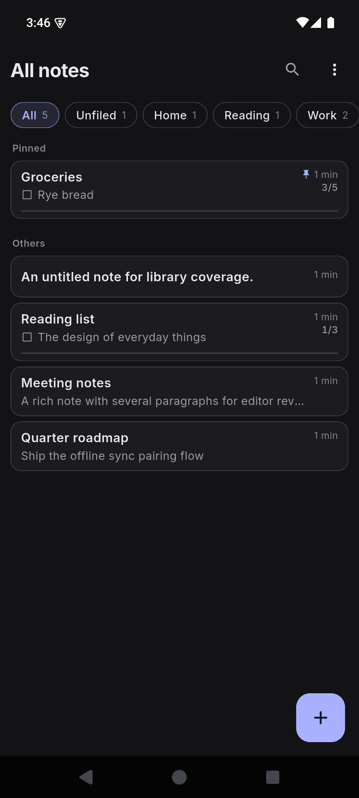

# Notes

Notes is an offline-first personal notes app for Android and native Linux,
built with Flutter. Notes are stored locally in an encrypted SQLite database;
device-to-device sync is optional.

## Download

- [Android arm64 APK](https://github.com/mmoptibuilds-commits/notes-app/releases)
- [Linux x64 archive](https://github.com/mmoptibuilds-commits/notes-app/releases)

You need Android 7.0 or later (in-app updates need Android 9 or later), or a Linux x64 desktop with GTK 3 and GLib runtime
libraries. Download the release archive, then verify it **before** extracting or
running anything from it. The checksum file only detects a damaged download:
it comes from the same place as the archive, so it cannot prove the archive is
genuine. The signed manifest can, and the verifier below hashes the archive
itself and compares it with the signed manifest. It uses Dart and a source
checkout of this project:

```sh
sha256sum -c notes-1.0.1-linux-x64.tar.gz.sha256     # damaged download?
dart tool/release/verify_manifest.dart --pubkeys tool/release_signing_pubkeys.json \
  --artifact notes-1.0.1-linux-x64.tar.gz notes-manifest.json notes-manifest.json.sig
```

Until the owner publishes a signing key in `tool/release_signing_pubkeys.json`
the second command cannot succeed, so releases cannot yet be verified this way;
see [docs/UPDATES.md](docs/UPDATES.md).

Extract the Linux archive and run `install.sh`; launch Notes from the app menu
or run `notes`. To upgrade, install a newer archive over the managed install,
or use the in-app update when Linux updating is enabled. Remove the program with
`uninstall.sh`. Your encrypted notes database and keyring entry stay in place
when installing, upgrading, or removing program files.

If Notes will not start, install your distribution's GTK 3 and GLib runtime
packages. Sync uses TCP port 47380 and UDP port 47381; allow those ports on the
local network when pairing. On Wayland, screen scaling and clipboard behaviour
depend on the compositor; XWayland may be needed on older desktops. The stable
channel currently has no published stable release; the preview release is not
offered as a stable update.

## Status

The automated suite has over 1,200 tests and passes in GitHub Actions. On
2026-11-20 the signed APK was installed in place on a Nothing Phone 2 (arm64,
Android 16) with existing notes intact, paired with the Linux app by QR code,
and synced both ways automatically. Tailscale has not been checked. No stable
release has been published yet; `v1.0.0-preview.1` is a pre-release. See the
[verification plan](docs/PLAN.md).

## Screenshots

<p align="center">
  
  
  
  
</p>

## Features

- Encrypted local notes with rich text, checklists, folders, search, and
  configurable appearance.
- Import of legacy Notebook backup JSON. The real backup was checked by
  counts only: 44 notes imported, 0 failures.
- Android JSON export through the system save picker and import from a
  content URI. Notes' own JSON exports can be restored with a preview,
  confirmation, a pre-restore snapshot, and one database transaction.
- Markdown export and optional direct device-to-device sync.

## Platforms

| Platform | Verified |
| --- | --- |
| Android | arm64 phone (Android 16) with in-place APK update; x86_64 Android 15 emulator |
| Linux | Native app, keyring persistence, Linux packaging, and end-to-end sync |

## Build from source

Requires Flutter 3.50.0 stable and JDK 21 for Android. The setup and release
steps are in [CLAUDE.md](CLAUDE.md) and [RELEASE.md](docs/RELEASE.md).

```bash
flutter pub get
dart format --output=none --set-exit-if-changed lib test tool
flutter analyze
flutter test
flutter build linux --release
```

An Android release build requires the existing signing configuration at
`android/key.properties`; release builds fail when it is missing. See
[third-party notices](docs/THIRD_PARTY_LICENSES.md) before redistributing.

## Project documentation

- [Product requirements](docs/PRODUCT.md)
- [Implementation progress and verification](docs/PLAN.md)
- [Architecture decisions](docs/DECISIONS.md)
- [Provenance review](docs/PROVENANCE.md)
- [Third-party licences](docs/THIRD_PARTY_LICENSES.md)
- [Stable release procedure](docs/RELEASE.md)
