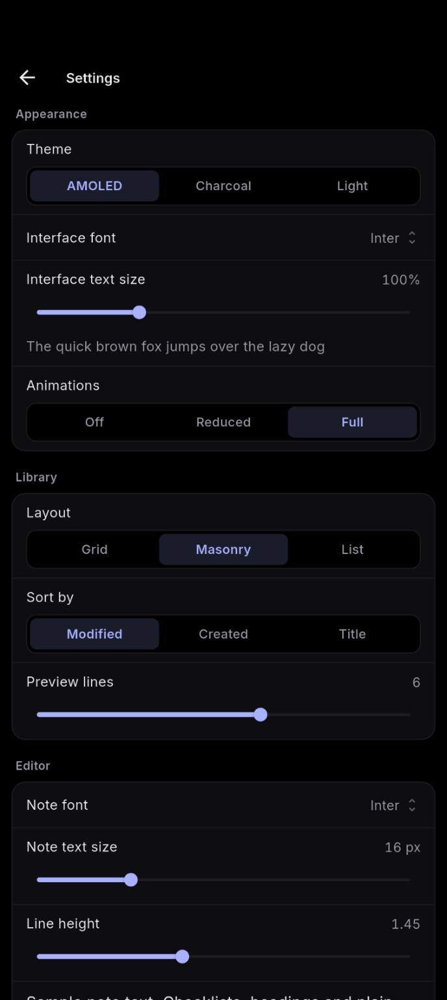
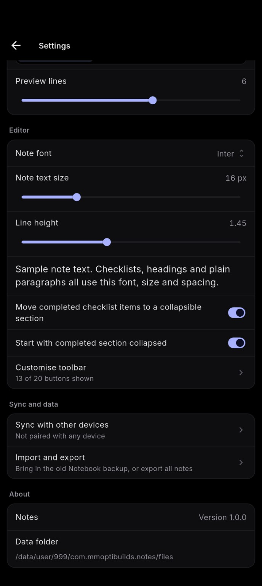

# Notes

Notes is an offline-first personal notes app for Android and native Linux,
built with Flutter. Notes are stored locally in an encrypted SQLite database;
device-to-device sync is optional.

## Status

The current implementation has 387 automated tests passing and 1 skipped
(integrator report, 2026-11-20). Android was exercised
on an x86_64 Android 15 emulator. Linux sync was verified end to end by
pairing with a code, resolving conflicts and deletions, and converging 476
notes. QR scanning, an arm64 phone, Android in-place upgrade, Tailscale, and
the first CI run remain unverified. No release has been published; the
`v1.0.0-preview.1` tag has no release assets. See the
[verification plan](docs/PLAN.md).

## Screenshots

<p align="center">
  
  
  
  
</p>

## Features

- Encrypted local notes with rich text, checklists, folders, search, and
  configurable appearance.
- Import of legacy Notebook backup JSON. The real backup was checked by
  counts only: 44 notes imported, 0 failures.
- Android JSON export through the system save picker and import from a
  content URI. Notes' own JSON exports can be restored with a preview,
  confirmation, a pre-restore snapshot, and one database transaction.
- Markdown export and optional direct device-to-device sync.

## Platforms

| Platform | Verified |
| --- | --- |
| Android | x86_64 Android 15 emulator; arm64 phone and in-place APK update pending |
| Linux | Native app, keyring persistence, Linux packaging, and end-to-end sync |

## Build from source

Requires Flutter 3.50.0 stable and JDK 21 for Android. The setup and release
steps are in [CLAUDE.md](CLAUDE.md) and [RELEASE.md](docs/RELEASE.md).

```bash
flutter pub get
dart format --output=none --set-exit-if-changed lib test tool
flutter analyze
flutter test
flutter build linux --release
```

An Android release build requires the existing signing configuration at
`android/key.properties`; release builds fail when it is missing. See
[third-party notices](docs/THIRD_PARTY_LICENSES.md) before redistributing.

## Project documentation

- [Product requirements](docs/PRODUCT.md)
- [Implementation progress and verification](docs/PLAN.md)
- [Architecture decisions](docs/DECISIONS.md)
- [Provenance review](docs/PROVENANCE.md)
- [Third-party licences](docs/THIRD_PARTY_LICENSES.md)
- [Stable release procedure](docs/RELEASE.md)
