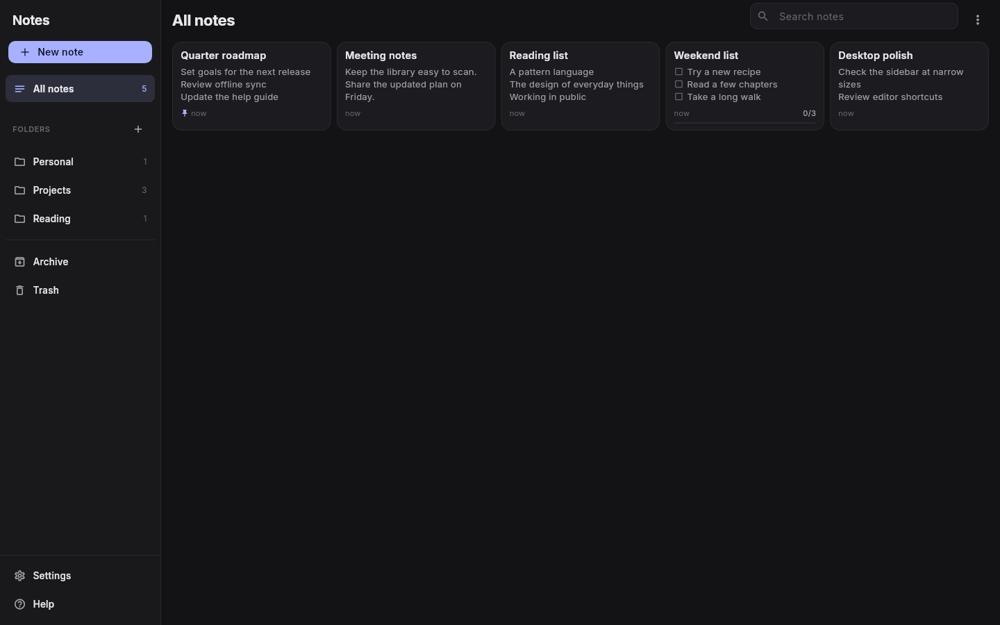
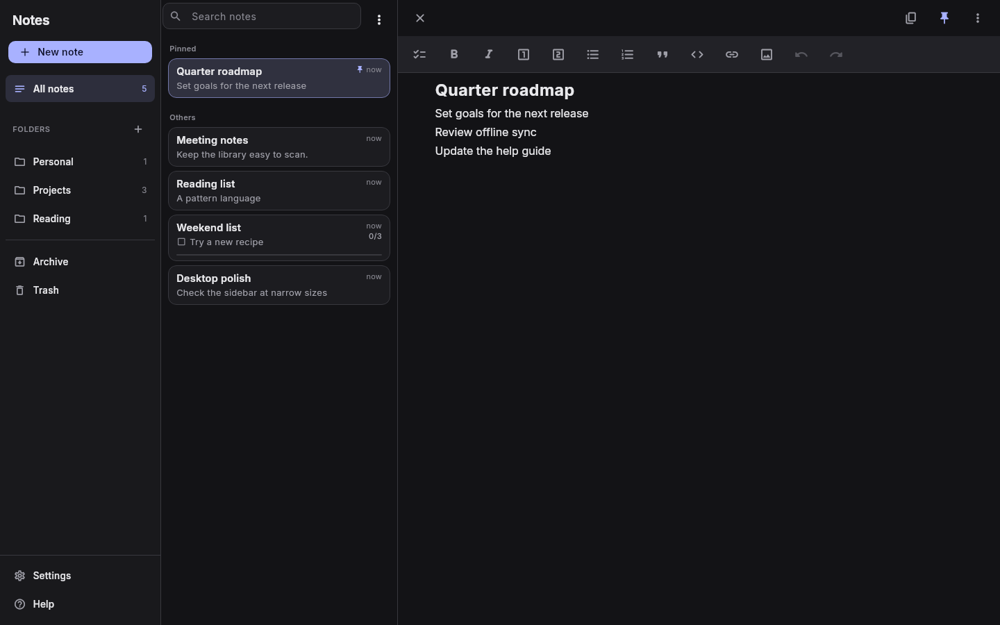
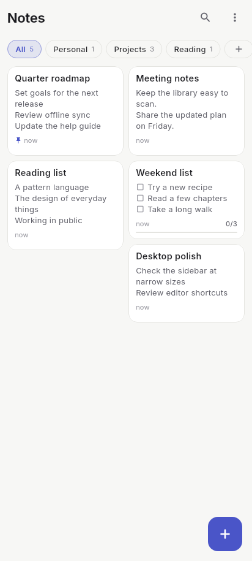
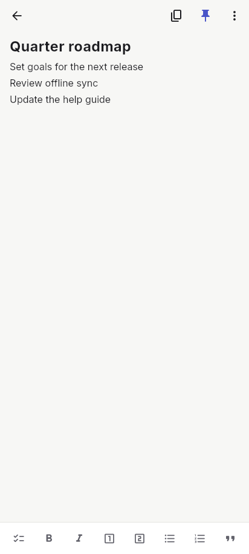

# Notes

Notes is an offline-first personal notes app for Android and Linux. Android
uses a phone layout; on Linux, a desktop sidebar stays beside the library and
notes open in an editor pane. Notes live in an encrypted local database, with
optional direct sync between your own devices over a local network, and
optional private cloud sync. Cloud sync requires the owner's Google account
and is off until the user signs in and uploads a library. The cloud server
stores notes as readable JSON; cloud sync is not end-to-end encrypted. LAN sync
remains available. Import and export Markdown notes as well as Notes
and legacy Notebook backups. Stable updates can download in the background and
are installed only after you confirm.

## Download

- [Android arm64 APK](https://github.com/mmoptibuilds-commits/notes-app/releases)
- [Linux x64 archive](https://github.com/mmoptibuilds-commits/notes-app/releases)

[](https://rookieenough.github.io/Orion-Data/app/?id=notes-app)

This source tree is Notes 1.3.0 (build 20261126). Installed copies of Notes
find later stable releases themselves (Settings → About → App
updates); pre-releases are never offered.

You need Android 7.0 or later (in-app updates need Android 9 or later), or a
Linux x64 desktop with GTK 3 and GLib runtime libraries.

### Verify a Linux download

Verify the archive **before** extracting or running anything from it. You need
`openssl` 3.0 or later, `sha256sum`, `sed` and `base64`, which most
distributions install by default (check with `openssl version`). You do not
need Dart, Flutter or a copy of this repository.

The `.sha256` file beside the archive only detects a damaged download: it comes
from the same place as the archive, so it cannot prove the archive is genuine.
The signed manifest can. Download `notes-manifest.json`,
`notes-manifest.json.sig` and the archive from the same release, save the
release public key shown in [Release signing key](#release-signing-key) as
`notes-release.pem`, and run, with the release's version in place of `1.2.0`:

```sh
sed -n 's/.*"signature":"\([^"]*\)".*/\1/p' notes-manifest.json.sig | base64 -d > notes-manifest.sig.bin
openssl pkeyutl -verify -pubin -inkey notes-release.pem -rawin -in notes-manifest.json -sigfile notes-manifest.sig.bin
grep -q "\"filename\":\"notes-1.2.0-linux-x64.tar.gz\",\"platform\":\"linux\",\"sha256\":\"$(sha256sum notes-1.2.0-linux-x64.tar.gz | cut -d' ' -f1)\"" notes-manifest.json && echo "archive matches the signed manifest"
```

Continue only if the second command prints `Signature Verified Successfully`
and the third prints `archive matches the signed manifest`. Anything else means
the download is damaged or not genuine: delete it. This manual check covers the
signature and the archive hash; the in-app updater also checks the manifest's
expiry date and release version.

### Release signing key

Release manifests are signed with the Ed25519 key `notes-release-1`. Save
these three lines as `notes-release.pem`:

```text
-----BEGIN PUBLIC KEY-----
MCowBQYDK2VwAyEA0Fp4/rw2KnbJD7bt6tA2spIhMTLLFtJwYiEHaivaXzM=
-----END PUBLIC KEY-----
```

Check the file before using it:

```sh
openssl pkey -pubin -in notes-release.pem -outform DER | sha256sum
```

It must print
`6947c0cb0e4311f7579a37d028f5b5e013326f93935b2b918cacfbd7a0ed0471`.
The same key is compiled into the app (`lib/update/pinned_keys.dart`) and
listed in `tool/release_signing_pubkeys.json`. All of these come from this
repository, so they protect against a tampered download, not against someone
who controls this GitHub account. Key rotation, expiry and recovery are
described in [docs/UPDATES.md](docs/UPDATES.md).

### Install on Linux

Extract the verified archive and run `./install.sh` from the extracted folder.
It installs for your user only, under `~/.local` (no root). Launch Notes from
the app menu or run `notes`. To upgrade, install a newer archive the same way
(the previous program files are kept as `~/.local/opt/notes.previous`), or use
the in-app updater when a stable update is available. Remove the program with
`uninstall.sh`. Your encrypted notes database and keyring entry stay in place
when installing, upgrading or removing program files.

If Notes will not start, install your distribution's GTK 3 and GLib runtime
packages. Sync uses TCP port 47380 and UDP port 47381; allow those ports on the
local network when pairing. See [troubleshooting](docs/TROUBLESHOOTING.md) for
firewall, keyring and update issues. On Wayland, screen scaling and clipboard
behaviour depend on the compositor; XWayland may be needed on older desktops.

### Install on Android

Download the APK on the phone and open it; Android asks you to allow installs
from that app first. Official APKs are signed with the project's release
certificate (SHA-256 in [docs/RELEASE.md](docs/RELEASE.md)), and Android only
updates an existing installation with an APK signed by the same certificate.

## Status

The previous stable release was Notes 1.2.0 (build 20261125), published 2026-11-24:
[release page](https://github.com/mmoptibuilds-commits/notes-app/releases/tag/v1.2.0).
Notes 1.1.0 was published 2026-11-21:
[release page](https://github.com/mmoptibuilds-commits/notes-app/releases/tag/v1.1.0).
The first stable release, Notes 1.0.0, was published 2026-11-21:
[release page](https://github.com/mmoptibuilds-commits/notes-app/releases/tag/v1.0.0).

On 2026-11-20/21, the app was verified on the owner's Nothing Phone 2 (arm64,
Android 16) and CachyOS/GNOME laptop: in-place APK upgrade and Linux install
upgrade kept existing data; QR pairing and automatic LAN sync worked in both
directions. The automatic updater now downloads and verifies signed releases,
but a real in-app upgrade still needs to be verified against a published
release. Tailscale has not been verified. A firewall subnet change that
interrupted sync is documented in [Troubleshooting](docs/TROUBLESHOOTING.md).

## Screenshots

On Linux, a sidebar holds your folders, Archive and Trash, and notes open in
an editor pane beside the note list:

<p align="center">
  
  
</p>

On Android, Notes keeps a phone layout with the formatting toolbar above the
keyboard:

<p align="center">
  
  
</p>

Screenshots use synthetic notes (`test/visual/review_screens_test.dart`).

## Features

- **Local-first storage:** notes saved in an encrypted local SQLite database; cloud use requires the owner's Google account and remains opt-in.
- **Rich text editing:** headings, lists, checklists, blockquotes, code blocks, links and inline formatting.
- **Organized library:** Unfiled is the default start view; choose Unfiled, All
  notes or Last viewed. Folders, search, grid/masonry/list layouts, sorting and
  preview controls keep notes easy to browse.
- **Appearance:** AMOLED, charcoal and light themes; adjustable typography and animation preferences.
- **Import and export:** import Markdown files (one note per file), export a
  note as Markdown, import legacy Notebook backup JSON, and export or restore
  Notes JSON with a preview and confirmation. JSON exports are not encrypted.
- **Device sync:** pair your own devices by QR code or copied code for direct,
  encrypted LAN sync. Optional cloud sync works across networks; the server
  stores readable note JSON and is not end-to-end encrypted. While cloud sync
  is on and the app is open, a saved note usually reaches your other open
  devices within fifteen seconds without tapping Sync now (Android syncs while the
  app is in the foreground). See
  [privacy and sync details](docs/PRODUCT.md#sync).
- **Stable updates:** Notes checks for stable releases and can download them in
  the background when automatic updates are enabled. You confirm installation
  through Android's installer or, on Linux, through a managed installation.

## Build from source

Requires Flutter 3.50.0 stable. Android builds also need JDK 21 and an Android
SDK. The [development guide](docs/DEVELOPMENT.md) covers setup and commands;
the [release procedure](docs/RELEASE.md) is for maintainers.

```bash
flutter pub get
dart format --output=none --set-exit-if-changed lib test tool
flutter analyze
flutter test
flutter build linux --release
flutter build apk --release --target-platform android-arm64
```

Production builds use the default private sync server address from the source;
no `NOTES_CLOUD_URL` define is needed.

An Android release build requires the existing signing configuration at
`android/key.properties`; release builds fail when it is missing. Official
update-compatible releases must be built with the project's existing private
signing key, which is kept outside this repository. A locally built APK signed
with a different key cannot update an existing installation. See
[third-party notices](docs/THIRD_PARTY_LICENSES.md) before redistributing.

## Project documentation

- [Product requirements](docs/PRODUCT.md)
- [Architecture](docs/ARCHITECTURE.md)
- [Installation](docs/INSTALL.md)
- [Troubleshooting](docs/TROUBLESHOOTING.md)
- [Development guide](docs/DEVELOPMENT.md)
- [Release notes](docs/RELEASE_NOTES.md)
- [Changelog](CHANGELOG.md)
- [Architecture decisions](docs/DECISIONS.md)
- [Provenance review](docs/PROVENANCE.md)
- [Third-party licences](docs/THIRD_PARTY_LICENSES.md)
- [Release procedure](docs/RELEASE.md)
